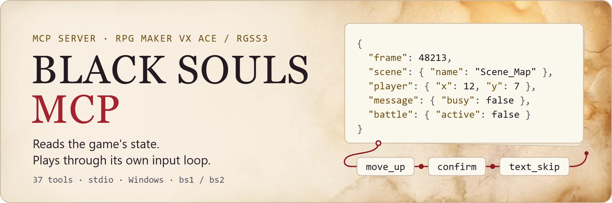
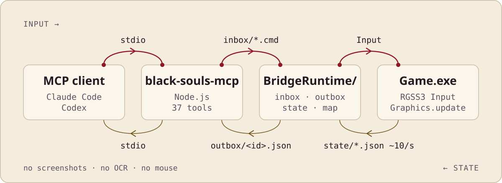

<p align="center">
  <picture>
    <source media="(prefers-color-scheme: dark)" srcset="./assets/readme/hero-dark.webp">
    
  </picture>
</p>

<div align="center">

[简体中文](README.md) · [English](README.en.md)

[](https://github.com/yk4464/black-souls-mcp/actions/workflows/ci.yml) [](https://nodejs.org/) [](https://github.com/yk4464/black-souls-mcp/blob/main/LICENSE) 

</div>

A local MCP for BLACK SOULS and BLACK SOULS II. It lets Claude Code, Codex, and similar agents connect to the game you select. Purely for fun.

Not screenshots, not OCR, not mouse simulation. It reads internal game objects and feeds actions into the native input loop, so a text-only model is enough. Navigation, dialogue, menus and battle were calibrated live for bs1. For bs2, loading, saving, dialogue, navigation, interaction, and ATB battle victory, escape and refusal of unavailable options have been tested live; using items in battle and multiple actions per turn have not.

> [!IMPORTANT]
> This repository contains only the bridge program and MCP source. It does not include, download, or distribute the game itself, saves, assets, keys, or unpacked commercial game data. Prepare your own legally obtained game files before use.

## What can it do?

Once connected, an MCP client can read:

- Scene, map, coordinates, facing, passability
- Nearby events, messages, choice menus
- Party level, HP, MP, states, gold
- Battle phase, units on both sides, currently available commands

It can also drive the character: move, confirm, cancel, page, dash, fast-forward text with Ctrl, or submit a whole run of consecutive actions at once.

<details>
<summary>Dash and Ctrl fast-forward key details</summary>

`dash_up/down/left/right` combines a direction with the game's Shift/run input on the same frame; repeatable `text_skip` mirrors holding Ctrl.

</details>

<details>
<summary>All 37 tools</summary>

37 tools in total, grouped by purpose:

| Group | Tools | Purpose |
|---|---|---|
| Process & diagnostics | `black_souls_select_game` · `black_souls_status` · `black_souls_launch` · `black_souls_kill` · `black_souls_list_saves` · `black_souls_health` | Select bs1 / bs2, check files and bridge, launch or force-quit the game, list saves and diagnose |
| State reading | `black_souls_get_state` · `black_souls_get_map` · `black_souls_situation` · `black_souls_get_full_map` · `black_souls_get_event` · `black_souls_get_scene_detail` | Scene, characters, messages, menus, battle; nearby or wide-range map; event pages and trigger conditions; deeper scene state |
| Game data | `black_souls_get_variables` · `black_souls_get_switches` · `black_souls_get_inventory` · `black_souls_get_party_detail` | Variables, switches, inventory and equipment, detailed party stats and skills |
| Input | `black_souls_input` · `black_souls_input_sequence` · `black_souls_wait` | Allowlisted keyboard actions, multi-step sequences, waiting for a game condition |
| High-level actions | `black_souls_navigate` · `black_souls_interact` · `black_souls_battle_options` · `black_souls_battle_action` · `black_souls_advance_dialogue` · `black_souls_save` · `black_souls_load` | Navigate and interact; read real command, skill, item and target indices from the game windows; submit one battle input (not necessarily a completed turn; magic and equipment change only if offered); advance dialogue, save and load |
| AI memory | `black_souls_scratchpad_read/write` · `black_souls_memory_read/write/delete` · `black_souls_goals_read/write/set_active` · `black_souls_session_log_append/read` | Session scratchpad, long-term game knowledge, goal hierarchy, persistent session log — all survive context resets and are kept separately for bs1 / bs2 |
| Evals | `black_souls_eval_status` | Scenario completion checks for `evals/runner.mjs` |

</details>

## How it works

<p align="center">
  <picture>
    <source media="(prefers-color-scheme: dark)" srcset="./assets/readme/how-it-works-dark.svg">
    
  </picture>
</p>

The bridge script refreshes state roughly 10 times per second; a new map snapshot is generated only when the position or map changes. Commands are processed frame by frame by the game's main thread, independent of window focus and of visual recognition. Query commands (variables, switches, inventory, full map, and so on) travel the same channel and are answered instantly without frame stepping.

Input goes only through the game's own movement / event / menu / battle handling. The interface never writes HP, items, variables, or story switches directly. Commands carry a process ID, launch generation, frame number, and command number, so stale state and duplicate commands are rejected; corrupt snapshots are skipped automatically. When RPG Maker suspends the game in the background, the bridge can resume the keyboard loop without stealing the foreground window.

## How does it compare to screenshot OCR and mouse simulation?

| | Screenshot / OCR | Mouse simulation | BLACK SOULS MCP |
|---|---|---|---|
| State source | Image recognition, easy to misread or miss | Image recognition | Reads game objects directly, frame-accurate |
| Needs window on top / foreground | Usually yes | Yes | No, resumes the input loop in the background |
| Network required | Often needs a vision model service | Depends on implementation | Local stdio only, no ports opened |
| Input path | Simulated clicks / keystrokes | Simulated clicks | Native game input loop, frame-synced |
| Risk of corrupting saves / story | Depends on implementation | Depends on implementation | Never writes HP, items, variables, or story switches directly |

## Quick start

To have an AI agent install it for you, copy the prompt below and send it:

```text
Please install black-souls-mcp on my Windows machine: https://github.com/yk4464/black-souls-mcp
Clone the repo, read the README "Quick start" section in full, then follow its steps. Rules:
1. Check for Node.js 18+ and Python 3.11+. If either is missing, tell me instead of installing it yourself.
2. Ask me first whether I use BLACK SOULS (bs1) or BLACK SOULS II (bs2), and where the original game is installed.
3. The game must come from a copy I legally own. Do not download the game or look for game files anywhere else.
4. Copy the original to runtime/game (bs1) or runtime/game2 (bs2) and only touch that copy. Never modify the Steam install directory.
5. For bs2, fully unpack Game.rgss3a into the copy first; only after that succeeds may you rename it to Game.rgss3a~.
6. Inject the bridge into the copy's Data/Scripts.rvdata2 with patch_rvdata2_binary.py as the README shows, keeping a backup.
7. Stop and ask me before running install.ps1: it modifies ~/.codex/config.toml (with an automatic backup). Add -Game bs2 for bs2.
8. If I use an MCP client other than Codex, register dist/index.js and the environment variables install.ps1 would write in that client's own way.
9. When done, run .\check.ps1 -IncludeRuntime (add -Game bs2 for bs2), report the result, and remind me to restart my MCP client.
If any step fails or you are unsure, stop and show me the raw error. Do not bypass checks.
```

Or install manually with the steps below.

| | |
|---|---|
| Platform | Windows 10/11 |
| Node.js | Node.js 18 or newer |
| Python | Python 3.11+ (only for the bridge script writing tools) |
| Game copy | Your own copy of BLACK SOULS or BLACK SOULS II |
| Script archive | `Data/Scripts.rvdata2` prepared from your own copy; this project never downloads or unpacks game assets for you |
| Supported engine | RPG Maker VX Ace / RGSS3 |
| Transport | Local `stdio` |
| Game version | bs1 and bs2 each ship one built-in `Game.exe` fingerprint; other versions can be configured per game |
| Distribution | Install from source; no npm package published yet |

### 1. Get the source and check it

```powershell
git clone https://github.com/yk4464/black-souls-mcp.git
Set-Location .\black-souls-mcp
npm.cmd ci
npm.cmd run check
```

### 2. Prepare the standalone runtime directory

Default layout:

```
runtime/
├─ game/
│  ├─ Game.exe
│  ├─ Game.ini
│  ├─ Game.rgss3a~
│  └─ Data/Scripts.rvdata2
├─ game2/
│  ├─ Game.exe
│  ├─ Game.ini
│  ├─ Game.rgss3a~
│  └─ Data/Scripts.rvdata2
└─ backup/
```

`runtime/` is Git-ignored. Preparation in short: copy your own game files into `runtime/game/`, make sure `Data/Scripts.rvdata2` is extracted (use `scripts/extract_rgss3a_file.py` if needed), then inject `rgss/BlackSoulsBridge.rb` into the script archive:

```powershell
python .\scripts\patch_rvdata2_binary.py .\runtime\game\Data\Scripts.rvdata2 .\rgss\BlackSoulsBridge.rb --backup .\runtime\backup\Scripts.rvdata2.bak
```

`patch_rvdata2_binary.py` uses only the Python standard library and preserves the original byte layout; prefer it. The alternative `patch_rvdata2.py` requires `python -m pip install -r requirements-tools.txt` first.

<details>
<summary>Preparing bs2</summary>

For bs2, copy your entire BLACK SOULS II game into `runtime/game2/`. **Extract every file** from `Game.rgss3a` into that directory *before* renaming the archive to `Game.rgss3a~`; extracting only `Scripts.rvdata2` makes other archived resources unavailable. Full extraction gives archive entries precedence over same-named loose files and reports every differing file (three PNGs differ in some bs2 copies):

```powershell
python .\scripts\extract_rgss3a_file.py .\runtime\game2\Game.rgss3a --all .\runtime\game2
Rename-Item -LiteralPath .\runtime\game2\Game.rgss3a -NewName 'Game.rgss3a~'
python .\scripts\patch_rvdata2_binary.py .\runtime\game2\Data\Scripts.rvdata2 .\rgss\BlackSoulsBridge.rb --backup .\runtime\backup\Scripts2.rvdata2.bak
```

</details>

Re-inject the current bridge into either game if an older version was prepared: older bridges lack the actual window lists and integer-button mapping. Never modify a copy while its game is running.

### 3. Install into Codex

```powershell
Set-ExecutionPolicy -Scope Process Bypass
.\install.ps1
```

The install script first backs up the current user's Codex `config.toml`, then writes the `black_souls` MCP registration. Restart Codex when it finishes.

<details>
<summary>External directory and dual-game install</summary>

Using an external directory:

```powershell
.\install.ps1 `
  -RuntimeRoot 'D:\BlackSoulsRuntime' `
  -GameDir 'D:\BlackSoulsRuntime\game'
```

With only bs2 prepared, use `.\install.ps1 -Game bs2`. The registration includes both game directories and fingerprints; pass `-Game2Dir` for a custom bs2 path. Call `black_souls_select_game` with no arguments to list the copies, then `{"game":"bs1"}` or `{"game":"bs2"}` to switch. Switching is refused while a game runs. The selection persists in `runtime/active_game.txt` across server restarts and overrides the registration's `BLACK_SOULS_GAME` initial default.

</details>

### 4. Verify

After restarting Codex, start with:

```
Call black_souls_status and check the game files and bridge status.
```

Then you can call, in order:

```
black_souls_launch
black_souls_get_state
black_souls_get_map
```

<details>
<summary>Advanced: action sequence JSON and engine fast-forward</summary>

Example arguments for a consecutive action run:

```json
{
  "steps": [
    { "action": "move_up" },
    { "wait_frames": 12 },
    { "action": "confirm" }
  ]
}
```

Running and fast text:

```json
{
  "steps": [
    { "action": "dash_up", "repeat": 3 },
    { "action": "text_skip", "repeat": 30 }
  ]
}
```

For optional fast-forwarding in the independent MCP copy, write one integer from `30` to `120` to
`BridgeRuntime/frame_rate.txt`. Valid values survive MCP game restarts; remove the file to restore the
launch-time frame rate. The effective value is returned as `frame_rate` in state snapshots.

</details>

## Game version fingerprint and environment variables

Get the SHA-256 of your own `Game.exe`:

```powershell
(Get-FileHash -Algorithm SHA256 -LiteralPath '.\runtime\game\Game.exe').Hash
```

Then set it in the current terminal:

```powershell
$env:BLACK_SOULS_GAME_EXE_SHA256 = '<YOUR_SHA256>'
```

For bs2, use `runtime/game2/Game.exe` and `BLACK_SOULS2_GAME_EXE_SHA256`. An empty fingerprint skips that game's comparison but still checks required files; only do this when you trust the source of your files.

<details>
<summary>Environment variables</summary>

| Variable | Description |
|---|---|
| `BLACK_SOULS_ROOT` | Runtime directory; defaults to `<repo>/runtime` |
| `BLACK_SOULS_DIR` | bs1 directory; defaults to `<runtime>/game` |
| `BLACK_SOULS_GAME_EXE_SHA256` | bs1 `Game.exe` checksum |
| `BLACK_SOULS2_DIR` | bs2 directory; defaults to `<runtime>/game2` |
| `BLACK_SOULS2_GAME_EXE_SHA256` | bs2 `Game.exe` checksum |
| `BLACK_SOULS_GAME` | Initial selection bs1 / bs2; persisted selection takes precedence |
| `BLACK_SOULS_TEST_TEMP` | Temporary directory for unit tests |
| `BLACK_SOULS_EXPECTED_SAVE_COUNT` | Optional minimum save count for integration tests |

</details>

## Limitations and troubleshooting

- Asset preparation and unpacking depend on the release you own, so there is no automated download flow
- RPG Maker may suspend the keyboard loop in the background; the service resumes it with a Windows message after verifying the process and path, without simulating the mouse or bringing the window to the foreground
- If a command times out and reports that "the game may already have received it", read the latest state first before deciding whether to retry, to avoid duplicate actions
- This project targets local trusted directories only; do not place `BridgeRuntime` somewhere other users can write

## Uninstall and rollback

```powershell
.\uninstall.ps1
.\rollback.ps1
```

Both touch only the Codex registration and its config backups; neither deletes the game or saves. To roll back to a specific backup:

```powershell
.\rollback.ps1 -ConfigBackup 'D:\BlackSoulsRuntime\backup\config.toml.before-black-souls-....bak'
```

## Testing

<details>
<summary>Test commands</summary>

```powershell
npm.cmd run check              # Build, MCP handshake, tool discovery, and synthetic tests
npm.cmd run test:integration   # Requires a prepared runtime directory
npm.cmd run test:live          # Launches the game and performs real keyboard input
.\check.ps1 -IncludeRuntime    # Checks source, game copy, and Codex registration
.\check.ps1 -IncludeRuntime -Game bs2    # Read-only bs2 preparation and fingerprint check
node evals\runner.mjs menu_navigation   # Run one eval scenario (requires the real game)
```

Live tests change the position or menu state of the current game session, but never save on their own. Keeping a copy of your own saves before running them is still recommended.

</details>

## Security and privacy

- The service uses local `stdio` only and never listens on a network port
- Command actions use a fixed allowlist, with limits on the queue, steps, and total frames
- The repository ignores game files, saves, runtime snapshots, logs, dependency caches, and build output
- Remove personal paths, save contents, and game files before filing an issue

Report security problems privately via [GitHub Security Advisory](https://github.com/yk4464/black-souls-mcp/security/advisories/new); use [Issues](https://github.com/yk4464/black-souls-mcp/issues) for everything else.

## Contributing

Please read [CONTRIBUTING.md](https://github.com/yk4464/black-souls-mcp/blob/main/CONTRIBUTING.md) first. `package.json` keeps `private: true` to prevent accidental npm publishing; this does not affect the MIT-licensed open source on GitHub.

## License and disclaimer

The source in this repository is under the [MIT License](https://github.com/yk4464/black-souls-mcp/blob/main/LICENSE).

BLACK SOULS, RPG Maker, related names, and game assets belong to their respective rights holders. This is an unofficial community tool with no affiliation to the game's authors, publishers, or the engine vendor.
