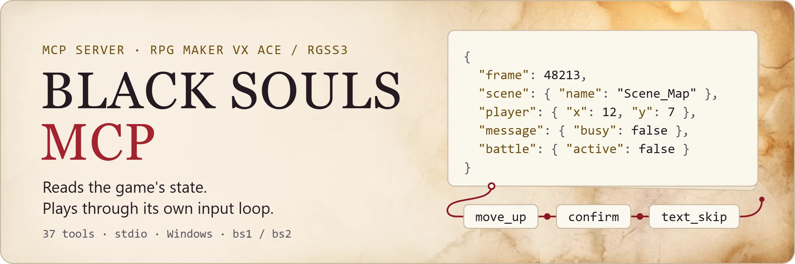
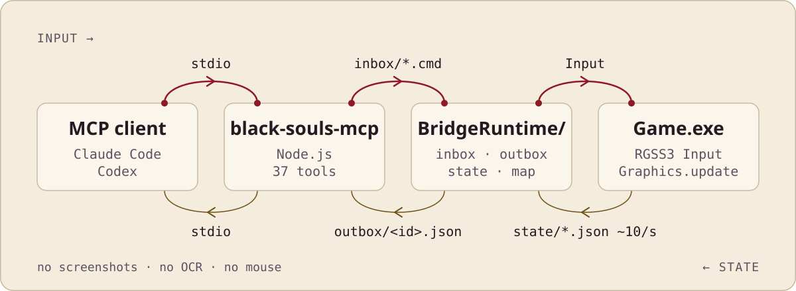

<p align="center">
  <picture>
    <source media="(prefers-color-scheme: dark)" srcset="./assets/readme/hero-dark.webp">
    
  </picture>
</p>

<div align="center">

[简体中文](README.md) · [English](README.en.md)

[](https://github.com/yk4464/black-souls-mcp/actions/workflows/ci.yml) [](https://nodejs.org/) [](https://github.com/yk4464/black-souls-mcp/blob/main/LICENSE) 

</div>

一个同时支持 BLACK SOULS 和 BLACK SOULS II 的 MCP。让 Claude Code / Codex 这类 agent 直接接入用户选中的游戏。纯娱乐。

原理很简单：读游戏内部对象拿状态，再把动作送进游戏自带的按键输入循环。不截图、不模拟鼠标、也不需要图片模型，所以非图像模型也能用。bs1 的寻路、对话、菜单和战斗曾实机校准；bs2 已实测读档、存档、对话、寻路、交互，以及 ATB 战斗的胜利结算、逃跑和不可用选项拦截，战斗中使用道具和多次行动尚未实测。

> [!IMPORTANT]
> 本仓库只包含桥接程序与 MCP 源码，不包含、不下载、也不分发游戏本体、存档、素材、密钥或解包后的商业游戏数据。使用前请自行准备合法获得的游戏文件。

## 能干嘛？

接入后，MCP 客户端能拿到：

- 场景、地图、坐标、朝向、通行信息
- 附近事件、消息、选项菜单
- 队伍等级、生命、魔力、异常状态、金钱
- 战斗阶段、双方单位、当前可用指令

也能操控角色：移动、确认、取消、翻页、冲刺、Ctrl 文本快进，或者一次提交一整套连续动作，比如"向上跑三步，再打开菜单看装备"。

<details>
<summary>冲刺与 Ctrl 快进的按键细节</summary>

`dash_up/down/left/right` 会在同一帧组合方向与游戏的 Shift/冲刺键；`text_skip` 对应 Ctrl，可用 `repeat` 连续保持。

</details>

<details>
<summary>37 个工具一览</summary>

共 37 个工具，按用途分组：

| 分组 | 工具 | 用途 |
|---|---|---|
| 进程与诊断 | `black_souls_select_game` · `black_souls_status` · `black_souls_launch` · `black_souls_kill` · `black_souls_list_saves` · `black_souls_health` | 选择 bs1 / bs2、检查文件与桥接、启动或强制结束游戏、列出存档与诊断 |
| 状态读取 | `black_souls_get_state` · `black_souls_get_map` · `black_souls_situation` · `black_souls_get_full_map` · `black_souls_get_event` · `black_souls_get_scene_detail` | 场景、角色、消息、菜单、战斗；附近或大范围地图；事件页与触发条件；场景深层状态 |
| 游戏数据 | `black_souls_get_variables` · `black_souls_get_switches` · `black_souls_get_inventory` · `black_souls_get_party_detail` | 变量、开关、背包物品与装备、队伍详细属性和技能 |
| 输入 | `black_souls_input` · `black_souls_input_sequence` · `black_souls_wait` | 白名单键盘动作、多步连续动作、等待某个游戏条件成立 |
| 高层动作 | `black_souls_navigate` · `black_souls_interact` · `black_souls_battle_options` · `black_souls_battle_action` · `black_souls_advance_dialogue` · `black_souls_save` · `black_souls_load` | 自动寻路与交互、按真实窗口列出当前可用指令和技能/道具/目标索引、提交一次战斗输入（不承诺整回合结算；魔法与换装备仅在游戏实际提供该指令时可用）、推进对话并选择选项、保存与读取 |
| AI 记忆 | `black_souls_scratchpad_read/write` · `black_souls_memory_read/write/delete` · `black_souls_goals_read/write/set_active` · `black_souls_session_log_append/read` | 会话便签、长期游戏知识库、目标层级、持久会话日志，跨上下文重置保留；bs1 / bs2 分别存放 |
| 评测 | `black_souls_eval_status` | 供 `evals/runner.mjs` 检查评测场景的完成条件 |

</details>

## 工作原理

<p align="center">
  <picture>
    <source media="(prefers-color-scheme: dark)" srcset="./assets/readme/how-it-works-dark.svg">
    
  </picture>
</p>

桥接脚本每秒约更新 10 次状态；地图仅在位置或地图变化时生成新快照。命令由游戏主线程逐帧处理，不依赖窗口焦点，也不依赖视觉识别。查询类命令（变量、开关、背包、全图等）走同一条通道即时应答，不占用帧步进。

输入只经过游戏自身的移动 / 事件 / 菜单 / 战斗处理逻辑，接口不会直接改生命、物品、变量或剧情开关。命令带着进程 ID、启动代次、帧号和命令编号，旧状态和重复命令会被拒绝；快照损坏会自动跳过；游戏在后台被 RPG Maker 暂停时，桥接能恢复键盘循环，不抢前台窗口。

## 跟截图 OCR和鼠标模拟比，差在哪？

| | 截图 / OCR 方案 | 鼠标模拟方案 | BLACK SOULS MCP |
|---|---|---|---|
| 状态来源 | 图像识别，容易看错、看漏 | 图像识别 | 直接读游戏内部对象，逐帧精确 |
| 需要窗口置顶 / 前台 | 通常需要 | 需要 | 不需要，后台也能恢复输入循环 |
| 是否联网 | 常需要视觉模型服务 | 视实现而定 | 纯本地 stdio，不开端口 |
| 输入路径 | 模拟点击 / 按键 | 模拟点击 | 走游戏原生输入循环，帧同步 |
| 会不会误改存档 / 剧情 | 视实现而定 | 视实现而定 | 不直接改生命、物品、变量、剧情开关 |

## 快速开始

想让 AI agent 帮你安装，可以把下面这段话复制给它：

```text
请帮我在 Windows 上安装 black-souls-mcp：https://github.com/yk4464/black-souls-mcp
先克隆仓库，完整阅读 README 的「快速开始」，再按它的步骤操作。要求：
1. 检查 Node.js 18+ 和 Python 3.11+；缺少时告诉我，不要自行安装。
2. 先问我用的是 BLACK SOULS（bs1）还是 BLACK SOULS II（bs2），以及原版游戏安装在哪个目录。
3. 游戏必须来自我自己合法拥有的副本。不要下载游戏，也不要去别处找游戏文件。
4. 把原版复制到 runtime/game（bs1）或 runtime/game2（bs2），之后只操作这个副本，绝不修改 Steam 原版目录。
5. bs2 必须先把 Game.rgss3a 全量解包到副本目录，确认成功后才能改名为 Game.rgss3a~。
6. 按 README 用 patch_rvdata2_binary.py 把桥接注入副本的 Data/Scripts.rvdata2，并保留备份。
7. 运行 install.ps1 前先停下来问我：它会修改 ~/.codex/config.toml（会自动备份）。bs2 要加 -Game bs2。
8. 如果我用的不是 Codex，就按我的 MCP 客户端自己的方式注册 dist/index.js 和 install.ps1 写入的那些环境变量。
9. 装完运行 .\check.ps1 -IncludeRuntime（bs2 加 -Game bs2），把结果告诉我，并提醒我重启 MCP 客户端。
任何一步失败或不确定时，停下来把原始错误给我看，不要绕过检查。
```

或者按下面的步骤手动安装。

| | |
|---|---|
| 平台 | Windows 10/11 |
| Node.js | Node.js 18 或更新版本 |
| Python | Python 3.11+（仅用于桥接脚本写入工具） |
| 游戏副本 | 自己的 BLACK SOULS 或 BLACK SOULS II 游戏副本 |
| 脚本档 | 已从自己的副本准备好 `Data/Scripts.rvdata2`；本项目不会自动下载或解包游戏资源 |
| 支持引擎 | RPG Maker VX Ace / RGSS3 |
| 传输方式 | 本地 `stdio` |
| 游戏版本 | bs1 / bs2 各有一个内置 `Game.exe` 指纹，其他版本可分别配置 |
| 发布方式 | 从源码安装；当前未发布 npm 包 |

### 1. 获取源码并检查

```powershell
git clone https://github.com/yk4464/black-souls-mcp.git
Set-Location .\black-souls-mcp
npm.cmd ci
npm.cmd run check
```

### 2. 准备独立运行目录

默认目录结构：

```
runtime/
├─ game/
│  ├─ Game.exe
│  ├─ Game.ini
│  ├─ Game.rgss3a~
│  └─ Data/Scripts.rvdata2
├─ game2/
│  ├─ Game.exe
│  ├─ Game.ini
│  ├─ Game.rgss3a~
│  └─ Data/Scripts.rvdata2
└─ backup/
```

`runtime/` 已被 Git 忽略。准备步骤概述：把自己的游戏副本复制到 `runtime/game/`，确保 `Data/Scripts.rvdata2` 已解出（可用 `scripts/extract_rgss3a_file.py`），然后用桥接写入工具把 `rgss/BlackSoulsBridge.rb` 注入脚本档：

```powershell
python .\scripts\patch_rvdata2_binary.py .\runtime\game\Data\Scripts.rvdata2 .\rgss\BlackSoulsBridge.rb --backup .\runtime\backup\Scripts.rvdata2.bak
```

`patch_rvdata2_binary.py` 只用 Python 标准库，保持原字节布局，优先使用；备选的 `patch_rvdata2.py` 需要先 `python -m pip install -r requirements-tools.txt`。

<details>
<summary>准备 bs2</summary>

准备 bs2：把自己的 BLACK SOULS II **整份**副本复制到 `runtime/game2/`，先将 `Game.rgss3a` **全量解包到该目录**，再改名为 `Game.rgss3a~`。不能只解出 `Scripts.rvdata2` 就改名，否则游戏读取不到归档里其余资源。全量解包会覆盖同名散放文件（归档优先），逐项打印有差异的文件及总数；已发现某些 bs2 副本有 3 张同名 PNG 不一致，不能盲目保留散放版本：

```powershell
python .\scripts\extract_rgss3a_file.py .\runtime\game2\Game.rgss3a --all .\runtime\game2
Rename-Item -LiteralPath .\runtime\game2\Game.rgss3a -NewName 'Game.rgss3a~'
python .\scripts\patch_rvdata2_binary.py .\runtime\game2\Data\Scripts.rvdata2 .\rgss\BlackSoulsBridge.rb --backup .\runtime\backup\Scripts2.rvdata2.bak
```

</details>

两部游戏若已注入旧版桥接，也需用当前 `rgss/BlackSoulsBridge.rb` 重新注入；旧桥接不包含真实窗口列表和整数按钮映射。以上命令仅适用于你自己的游戏副本，勿在游戏运行时改写。

### 3. 安装到 Codex

```powershell
Set-ExecutionPolicy -Scope Process Bypass
.\install.ps1
```

安装脚本会先备份当前用户的 Codex `config.toml`，再写入 `black_souls` MCP 注册。完成后重启 Codex。

<details>
<summary>外部目录与双游戏安装</summary>

使用外部目录：

```powershell
.\install.ps1 `
  -RuntimeRoot 'D:\BlackSoulsRuntime' `
  -GameDir 'D:\BlackSoulsRuntime\game'
```

只有 bs2 副本时用 `.\install.ps1 -Game bs2`；同时准备两部时，注册会保留 `BLACK_SOULS_DIR`、`BLACK_SOULS2_DIR` 及各自指纹。在 MCP 内先调用 `black_souls_select_game`（不传 `game`）查看准备情况，再传 `{"game":"bs1"}` 或 `{"game":"bs2"}` 切换；游戏运行中不能切换。选择写入 `runtime/active_game.txt`，MCP 重启后保留，优先级高于安装时的 `BLACK_SOULS_GAME` 默认值。自定义 bs2 路径传 `-Game2Dir`。

</details>

### 4. 验证

重启 Codex 后先调用：

```
请调用 black_souls_status，检查游戏文件和桥接状态。
```

随后可以依次调用：

```
black_souls_launch
black_souls_get_state
black_souls_get_map
```

<details>
<summary>进阶：连续动作 JSON 与引擎快进</summary>

连续动作参数示例：

```json
{
  "steps": [
    { "action": "move_up" },
    { "wait_frames": 12 },
    { "action": "confirm" }
  ]
}
```

加速移动与文本：

```json
{
  "steps": [
    { "action": "dash_up", "repeat": 3 },
    { "action": "text_skip", "repeat": 30 }
  ]
}
```

仅对独立 MCP 游戏副本启用可选的引擎快进：在游戏目录下创建
`BridgeRuntime/frame_rate.txt`，内容写一个 `30`–`120` 的整数。有效配置会跨 MCP 游戏重启保留；删除此文件即恢复游戏启动时帧率；
`black_souls_get_state` 的 `frame_rate` 字段返回实际值。快进只缩短真实游戏帧等待，不直接改魂、
属性、掉落、敌人或剧情。调高前应先保存并用少量战斗验证先手、伤害与结算；高难度仍可能导致死亡和掉魂。

</details>

## 游戏版本指纹与环境变量

获取自己的 `Game.exe` SHA-256：

```powershell
(Get-FileHash -Algorithm SHA256 -LiteralPath '.\runtime\game\Game.exe').Hash
```

然后在当前终端指定：

```powershell
$env:BLACK_SOULS_GAME_EXE_SHA256 = '<YOUR_SHA256>'
```

bs2 对应 `runtime/game2/Game.exe` 和 `BLACK_SOULS2_GAME_EXE_SHA256`。各自的指纹设为空字符串会跳过比较，但仍会检查必需文件是否存在；只有确认文件来源后才应这样做。

<details>
<summary>环境变量</summary>

| 变量 | 说明 |
|---|---|
| `BLACK_SOULS_ROOT` | 运行目录；默认 `<仓库>/runtime` |
| `BLACK_SOULS_DIR` | bs1 独立游戏目录，默认 `<运行目录>/game` |
| `BLACK_SOULS_GAME_EXE_SHA256` | bs1 的 `Game.exe` 校验值 |
| `BLACK_SOULS2_DIR` | bs2 独立游戏目录，默认 `<运行目录>/game2` |
| `BLACK_SOULS2_GAME_EXE_SHA256` | bs2 的 `Game.exe` 校验值 |
| `BLACK_SOULS_GAME` | 初始游戏 bs1 / bs2；持久选择文件优先 |
| `BLACK_SOULS_TEST_TEMP` | 单元测试临时目录 |
| `BLACK_SOULS_EXPECTED_SAVE_COUNT` | 可选的集成测试最少存档数 |

</details>

## 限制与故障提示

- 游戏资源准备与解包方式取决于发行版本，因此未做成自动下载流程
- RPG Maker 在后台可能暂停键盘循环；服务使用已核对进程和路径的 Windows 消息恢复循环，不模拟鼠标，也不把窗口切到前台
- 命令超时后若提示"游戏可能已经接收"，应先读取最新状态，再决定是否重试，避免重复动作
- 本项目仅面向本机可信目录，不应把 `BridgeRuntime` 放到其他用户可写的位置

## 卸载与回滚

```powershell
.\uninstall.ps1
.\rollback.ps1
```

两者只处理 Codex 注册及其配置备份，不删除游戏或存档。指定某个备份进行回滚：

```powershell
.\rollback.ps1 -ConfigBackup 'D:\BlackSoulsRuntime\backup\config.toml.before-black-souls-....bak'
```

## 测试

<details>
<summary>测试命令</summary>

```powershell
npm.cmd run check              # 构建、MCP 握手、工具发现与合成测试
npm.cmd run test:integration   # 需要已准备的运行目录
npm.cmd run test:live          # 启动游戏并执行真实键盘输入
.\check.ps1 -IncludeRuntime    # 检查源码、游戏副本和 Codex 注册
.\check.ps1 -IncludeRuntime -Game bs2    # 只读核对 bs2 的准备目录与指纹
node evals\runner.mjs menu_navigation   # 运行一个评测场景（需要真实游戏）
```

真实测试会改变当前游戏会话中的位置或菜单，但不会主动保存。运行前仍建议保留自己的存档副本。

</details>

## 安全与隐私

- 服务只使用本地 `stdio`，不会监听网络端口
- 命令动作使用固定白名单，并限制队列、步骤和总帧数
- 仓库忽略游戏、存档、运行快照、日志、依赖缓存和构建产物
- 提交问题前请移除个人路径、存档内容和游戏文件

安全问题请通过 [GitHub Security Advisory](https://github.com/yk4464/black-souls-mcp/security/advisories/new) 私下报告；其他问题使用 [Issues](https://github.com/yk4464/black-souls-mcp/issues)。

## 参与贡献

请先阅读 [CONTRIBUTING.md](https://github.com/yk4464/black-souls-mcp/blob/main/CONTRIBUTING.md)。`package.json` 中保留 `private: true`，用于防止误发布到 npm；这不影响 GitHub 上的 MIT 开源源码。

## 许可证与声明

本仓库源码采用 [MIT License](https://github.com/yk4464/black-souls-mcp/blob/main/LICENSE)。

BLACK SOULS、RPG Maker、相关名称和游戏资产归各自权利人所有；本项目是非官方社区工具，与游戏作者、发行商及引擎厂商无隶属关系。
